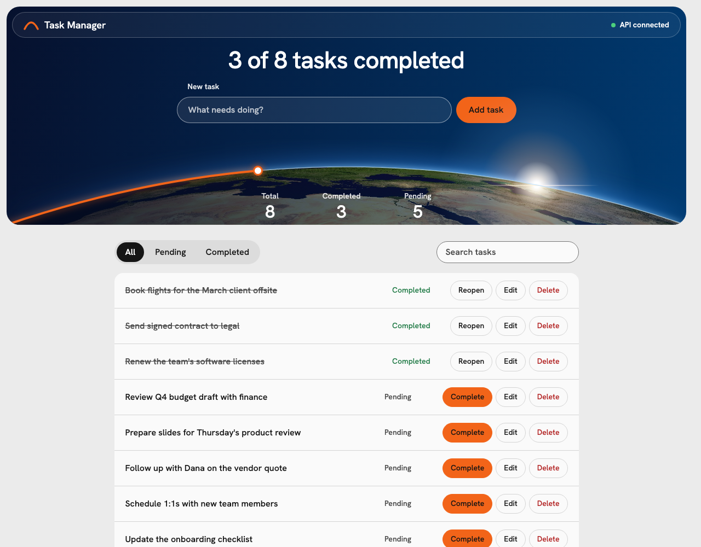

# Task Manager



A task manager with a Flask API, a React frontend and Docker Compose.

## Build and run

```bash
docker-compose up --build
```

| Service | URL |
|---|---|
| Frontend | http://localhost:3000 |
| API | http://localhost:5000/tasks |

**Port conflicts:** macOS AirPlay Receiver listens on port 5000. Turn it off in System Settings, or choose other ports:

```bash
API_PORT=5050 WEB_PORT=3030 docker-compose up --build
```

Stop with `docker-compose down`.

## API

Required endpoints:

| Method | Endpoint | Success | Description |
|---|---|---|---|
| GET | `/tasks` | 200 | List tasks |
| POST | `/tasks` | 201 | Create a task from `{"title": "..."}` |
| PUT | `/tasks/<id>/complete` | 200 | Mark a task completed |
| DELETE | `/tasks/<id>` | 204 | Delete a task |
| GET | `/tasks/stats` | 200 | Return `total`, `completed`, `pending` |

Added endpoints:

| Method | Endpoint | Description |
|---|---|---|
| GET | `/tasks?status=pending\|completed&q=text` | Filter by status and search titles |
| GET | `/tasks/<id>` | Get one task |
| PATCH | `/tasks/<id>` | Rename a task |
| PUT | `/tasks/<id>/reopen` | Mark a task pending again |
| GET | `/health` | Container health check |

Tasks also carry `created_at` and `completed_at`, in addition to the required `id`, `title` and `completed`.

## Frontend

- Required: task list with status, add form, complete and delete buttons, and total, completed and pending counts.
- Added: rename, reopen, delete confirmation, status filter, search, and a connection banner when the API is unreachable.
- The orange arc on the planet horizon fills as tasks are completed.
- The list refreshes every 3 seconds, so tasks created with `curl` appear without a reload.

## Structure

```
backend/   app.py (routes, validation, errors), store.py (in-memory store), tests/
frontend/  src/ (React), nginx.conf (serves the build, proxies /api to the backend)
scripts/   smoke.sh (end-to-end checks against the running containers)
```

The browser calls `/api` on port 3000 and nginx forwards it to `backend:5000`. The browser sees one origin, so the API needs no CORS configuration.

## Tests

```bash
(cd backend && python3 -m venv .venv && .venv/bin/pip install -r requirements-dev.txt && .venv/bin/pytest -q)
```

```bash
(cd frontend && npm ci && npm test)
```

```bash
SEED_TASKS=0 docker-compose up --build -d && scripts/smoke.sh
```

`smoke.sh` expects an empty task list, which `SEED_TASKS=0` provides. Before a rerun, run `docker-compose restart backend`. On other ports, run `export API_PORT=5050 WEB_PORT=3030` first.

Tested in Chromium only, with no screen reader or automated accessibility scan.

| Suite | Count | Covers |
|---|---|---|
| Backend, pytest | 33 | Lifecycle, POST validation, blank-title PATCH, body size limit, 404s on each ID route, JSON 405 and 500, no ID reuse, unique IDs across 200 threaded creates through the test client |
| Frontend, Vitest | 8 | Rendering from a stubbed API, focus when a row leaves a filter, add and complete, server validation message, delete confirmation, rejected rename, hung API, unreachable API |
| Smoke, curl | 12 | The sample calls and error paths against the containers, including through the nginx proxy |

## Assumptions and simplifications

- The app starts with 8 example tasks, so IDs 1 to 8 exist and new tasks start at 9. Set `SEED_TASKS=0` to start empty.
- Tasks live in process memory and are lost when the backend restarts, as the brief allows.
- Gunicorn runs one worker with 8 threads. A second worker would hold a second task list. A lock protects the store across threads.
- IDs are integers from 1 and are not reused after a delete. They restart from 1 when the backend restarts.
- Titles are trimmed, cannot be blank or contain control characters, and are limited to 200 characters. Request bodies are limited to 64 KB. Duplicate titles are allowed.
- Completing a completed task returns 200 and keeps the original `completed_at`.
- There is no authentication, and the API is open to anyone who can reach the port.
- The Earth image is NASA Blue Marble (`Whole_world_-_land_and_oceans_12000.jpg`, public domain, from Wikimedia Commons), projected onto a sphere by `scripts/project_earth.py` and stored in the repo, so the app needs no external requests. Rerunning the script requires `numpy` and `pillow`; the app does not.
- AI tools were used, as the brief allows: I set the scope and directed the work, Claude Code wrote the code, and I reviewed it and ran the tests.

## Questions

### How did you handle API errors?

Every error from Flask returns the same JSON body, including its own 404 and 405. Gunicorn and nginx errors, such as 502 or 504, are not JSON, and the frontend treats them as offline:

```json
{"error": {"code": "task_not_found", "message": "Task 99 does not exist."}}
```

| Status | Case |
|---|---|
| 400 | Malformed JSON, non-object body, invalid title, unknown `status` filter |
| 404 | Unknown task ID or route |
| 405 | Wrong method on a route |
| 413 | Body over 64 KB |
| 415 | POST or PATCH without `Content-Type: application/json` |
| 500 | Unhandled exception, logged on the server, with no internal details in the response |

The frontend separates API answers from no answer. Validation messages from the server appear beside the input, and the input keeps its text. A failed action shows a dismissible banner and refreshes the list, which removes a task deleted elsewhere. A network failure, hang or gateway error page shows the offline banner, and polling reconnects without a reload. Polls never overlap, so a slow response cannot be discarded by the next one.

### What tests would you write if given more time?

- Browser tests with Playwright through the Docker stack: add, complete, rename, delete, filter, and recovery after a backend restart.
- Frontend tests for Escape to cancel, reopen, and filter and search requests.
- Load test of the single-worker setup to measure its limit.
- Schema tests that fail if a response drops a required field.

### What would you improve with 1 extra hour?

- Persistence: replace `TaskStore` with SQLite on a Docker volume. This is the largest gap, because a restart loses all tasks.
- CI: run the three test suites on each push with GitHub Actions.

Beyond the hour: undo for delete, pagination, and server-sent events to replace polling.
